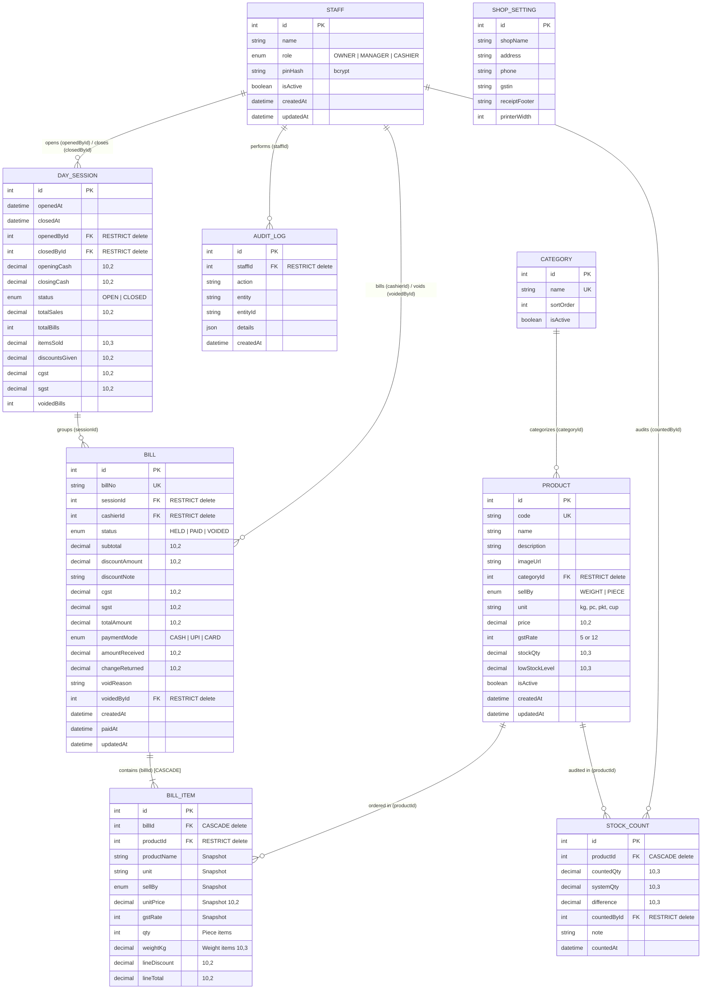

# Bake & Brew POS — Database Architecture & Setup Guide

A complete database layer for the **Bake & Brew** bakery & tea stall billing application. Built with **Prisma ORM** targeting **MySQL** running on **XAMPP / WAMP** for direct visibility and management via **phpMyAdmin**.

---

## 1. Entity-Relationship (ER) Diagram



---

## 2. Directory Structure

```text
d:/billing demo/database/
├── .env                  # Active environment variables (git-ignored)
├── .env.example          # Template with default XAMPP connection string
├── package.json          # Node project config with prisma.seed entry
├── crud-reference.md     # Copy-pasteable Prisma queries for your future backend
├── README.md             # This guide with ER diagram & setup commands
└── prisma/
    ├── schema.prisma     # Production-ready MySQL schema with utf8mb4 & indexes
    └── seed.js           # Idempotent seed script (staff, categories, 20+ products, bill)
```

---

## 3. Step-by-Step XAMPP Setup Commands

Open your terminal (PowerShell or Command Prompt) and run the following exact commands in order:

### Step 1: Start MySQL in XAMPP
1. Open the **XAMPP Control Panel**.
2. Click **Start** next to **MySQL** (and **Apache** if you want phpMyAdmin).
3. Confirm that the port shows `3306` and the status shows green.

### Step 2: Navigate to the Database Directory
```bash
cd "d:\billing demo\database"
```

### Step 3: Install Dependencies
Install Prisma CLI as a dev dependency, and the client + bcryptjs as runtime dependencies:
```bash
npm i -D prisma
npm i @prisma/client bcryptjs
```

### Step 4: Verify Environment Configuration
Ensure your `.env` file exists and has:
```env
DATABASE_URL="mysql://root:@localhost:3306/bake_and_brew"
```
*(If you have set a MySQL root password in XAMPP, change `root:@` to `root:yourpassword@`)*.

### Step 5: Validate the Prisma Schema
```bash
npx prisma validate
```
Expected output:
```text
The schema at prisma/schema.prisma is valid 🚀
```

### Step 6: Run Migrations
This command creates the database `bake_and_brew` in MySQL (if it does not already exist), creates all 9 tables, indexes, and foreign keys, and generates `@prisma/client`:
```bash
npx prisma migrate dev --name init
```

### Step 7: Seed the Database
Run the idempotent seed script to populate staff, categories, 24 products, shop settings, day session, and a sample bill:
```bash
npx prisma db seed
```
Expected output:
```text
🌱 Starting Bake & Brew database seed...
👤 Seeding Staff...
🏷️  Seeding Categories...
🥐 Seeding Products...
⚙️  Seeding Shop Settings...
🌙 Seeding Open Day Session...
🧾 Seeding Sample PAID Bill with 2 items (1 weight + 1 piece)...
✅ Seed completed successfully!
   Staff created: 3 (Owner PIN: 0000, Manager PIN: 4321, Cashier PIN: 1234)
   Categories created: 8
   Products created: 20
   Sample Bill created: BB-261014-001 with 2 items (Total: ₹367.50)
```

---

## 4. How to Open & Inspect in phpMyAdmin

1. Open your browser and navigate to:
   ```text
   http://localhost/phpmyadmin
   ```
2. In the left sidebar, click on the **`bake_and_brew`** database.
3. You will see all 9 tables:
   - `audit_logs`
   - `bill_items`
   - `bills`
   - `categories`
   - `day_sessions`
   - `products`
   - `shop_settings`
   - `staff`
   - `stock_counts`

---

## 5. phpMyAdmin Verification Checklist

Use this checklist to confirm that everything is functioning correctly:

- [ ] **Check Character Set & Tamil Text / Rupee Symbol Support**:
  - Open table `shop_settings` and click **Browse**.
  - Check the `receiptFooter` column: Confirm that Tamil text (`நன்றி! மீண்டும் வருக!`) renders without question marks or corruption.
  - Collation should show `utf8mb4_unicode_ci` or `utf8mb4_0900_ai_ci`.

- [ ] **Check Foreign Keys in Relation View**:
  - Click on the `products` table in the left sidebar.
  - Click the **Structure** tab at the top.
  - Click **Relation view** (found just below the column list).
  - Verify that `categoryId` links to `categories(id)` with `ON DELETE: RESTRICT` and `ON UPDATE: CASCADE`.
  - Repeat for `bill_items`:
    - `billId` -> `bills(id)` with `ON DELETE: CASCADE`.
    - `productId` -> `products(id)` with `ON DELETE: RESTRICT`.

- [ ] **Check Interactive ER Diagram in phpMyAdmin Designer**:
  - In phpMyAdmin, click the database name `bake_and_brew`.
  - In the top navigation menu, click **More** -> **Designer**.
  - Verify all relational lines connect between parent and child tables.

- [ ] **Test Delete Rule (ON DELETE RESTRICT)**:
  - In phpMyAdmin, click on table `categories` and click **Browse**.
  - Locate `Tea & Coffee` (which currently has products like Cutting Chai and Masala Chai).
  - Click **Delete** next to `Tea & Coffee` and confirm.
  - **Expected Result**: MySQL rejects the deletion with an error:
    ```text
    #1451 - Cannot delete or update a parent row: a foreign key constraint fails (`bake_and_brew`.`products`, CONSTRAINT `products_categoryId_fkey` FOREIGN KEY (`categoryId`) REFERENCES `categories` (`id`) ON DELETE RESTRICT)
    ```
    This confirms data protection is active and prevents accidental category deletion.

- [ ] **Test Cascade Delete (ON DELETE CASCADE)**:
  - Table `bills` contains sample bill `BB-261014-001`.
  - If you delete this bill, both associated rows in `bill_items` are automatically deleted without leaving orphan rows.

---

## 6. Seed Credentials Reference

| Role | Staff Name | Plain PIN (for app UI) | Stored in DB (`pinHash`) |
| :--- | :--- | :--- | :--- |
| **OWNER** | Karthik Raja | `0000` | Salted bcrypt hash |
| **MANAGER** | Suresh Kumar | `4321` | Salted bcrypt hash |
| **CASHIER** | Raju | `1234` | Salted bcrypt hash |
